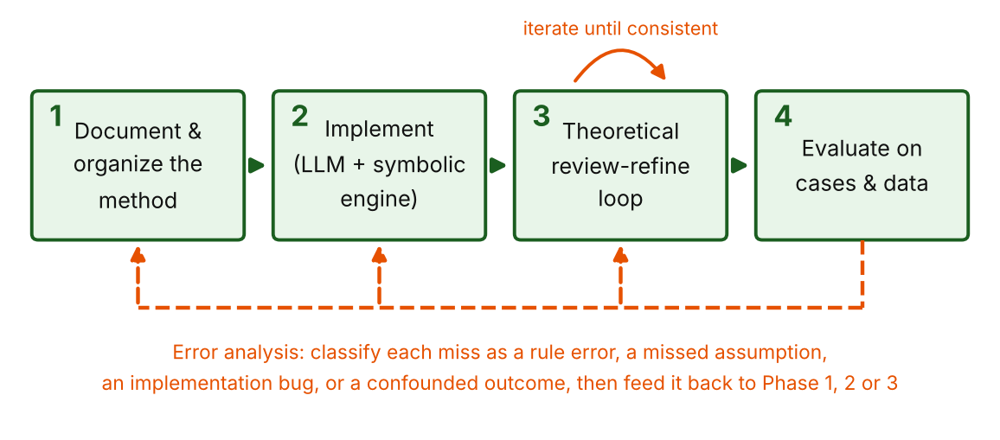
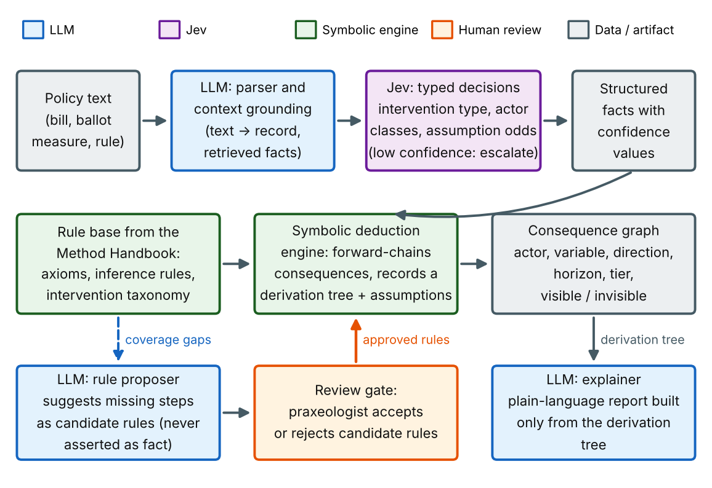
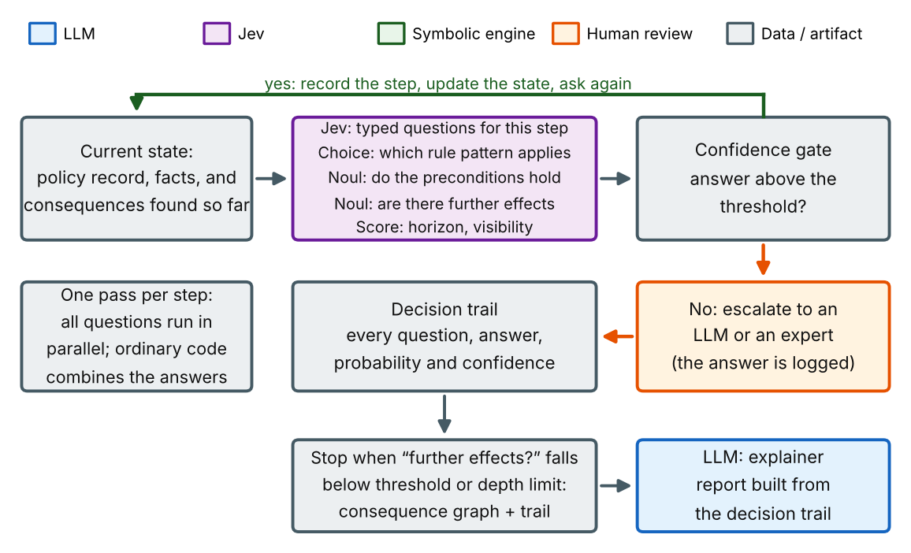

% Praxeological Policy Analysis System
% Project plan: from documented method to evaluated AI system
% Daniel Jin  |  October 2026  |  Working draft, version 3

# What changed in version 3

Version 3 keeps the four-phase structure, the two configurations and the tier system of version 2. It adds the rules that make the evaluation hard to argue with, fills two gaps in the reasoning method, and reorders the work so that problems surface early. The main changes:

| Area | Change in version 3 | Where |
|---|---|---|
| Falsifiability | Every assumption gets a probability **at prediction time**. Assumptions are scored separately, and the headline accuracy counts misses caused by failed assumptions, so no miss can be excused after the fact. | 2, 3, 7.3 |
| Ground truth | Outcome cards record null and opposite findings, not only observed effects. Predictions are matched against a fixed variable vocabulary, with near-duplicates merged. | 7.2, 7.4 |
| Opposing effects | A defined procedure for combining chains that push the same variable in opposite directions. "Ambiguous" is a valid answer. | 4.5 |
| Market relations | A new ontology concept for substitutes, complements and inputs, with sourced facts. Hard depth cap and pruning rule for second-order effects. | 4.2, 4.3 |
| Engine | Recommendation: answer set programming (clingo) or Datalog with provenance, and assumption tracking modelled on an ATMS. | 4.4, 5.4 |
| Jev dependency | A single `Decider` interface. Everything is built and calibrated against an LLM first, and Jev is swapped in when access arrives. | 5.1 |
| Calibration data | A labelled question bank of at least 200 items per question type, generated from worked examples and toy variants. | 4.6, 6.1 |
| Scope | Version 1 covers three intervention families: price controls, taxes and subsidies, licensing and entry barriers. Monetary and credit policy is deferred. | 1, 4.1 |
| Order of work | A thin end-to-end slice by week 3. Outcome cards start in week 2. Forward-looking log starts in week 8. | 5.5, 8 |
| Statistics | Cluster bootstrap at the consequence level, and success criteria rewritten for a small held-out set. | 7.8, 9 |
| Contamination | Context retrieval restricted to sources dated before enactment, not only the prompts. | 5.3, 7.2 |
| Fairness check | Repeals, deregulation and empirically contested cases are added to every evaluation set. | 7.1 |

# 1. Summary

Policies are usually justified by their visible, intended effects. Their invisible effects, such as the people who respond to new incentives in unplanned ways, the opportunities given up, and the costs that fall on groups nobody was counting, tend to surface only after the damage is done. Mainstream policy analysis is often driven by statistical or formal models, which describe average behavior well but do not reason explicitly about why individuals act as they do.

This project builds a system that analyzes the consequences of a policy using praxeology, the deductive study of purposeful human action developed by Ludwig von Mises and extended by the Austrian School. The system should produce predictions that are both accurate and interpretable: every predicted consequence comes with an explicit causal chain that shows how it follows from the policy and from stated premises, and with the probability that each premise holds in the case at hand.

The work has four phases, run as a loop rather than a straight line:

1. **Document and organize the method.** Turn praxeological reasoning from books and expert practice into an explicit, structured procedure with rules, categories and worked examples.
2. **Implement it with AI.** Combine three kinds of model: Jev, a fast model that returns typed decisions with probabilities; a symbolic reasoning engine, which does formal deduction and keeps the proof; and LLMs, which read policy text, supply context and explain results. Two configurations are built and compared.
3. **Run a theoretical review-refine loop.** Stress-test the method and the implementation on paper and with experts before any real-world data is involved.
4. **Evaluate and feed the results back.** Measure accuracy (F1) and interpretability on toy and historical cases, then use the errors to revise Phases 1 to 3.

Version 1 is deliberately narrow. It covers three intervention families (price controls, taxes and subsidies, licensing and entry barriers), and a thin end-to-end slice, from policy text to a scored historical case, is built in the first three weeks so that interface problems appear before the Handbook is finished.



## Plan at a glance

| Phase | Main activities | Deliverables | Exit criterion (proposed) |
|---|---|---|---|
| 0. Thin slice | One rule, one historical case, end to end: text, record, engine, explanation, score | Working skeleton of every component; first outcome card | The case runs end to end and gets a score |
| 1. Document the method | Collect sources, define the ontology, rules and workflow, write worked examples, build the calibration question bank | Method Handbook, rule catalog, intervention taxonomy, 25+ worked examples, labelled question bank | Experts can reproduce each worked example from the Handbook alone |
| 2. Implement | Build the pipeline in two configurations behind one `Decider` interface: parser, typed decisions, engine, verifier, explainer | Two working prototypes, rule base and question schemas in code, test suite, consequence-graph format | Both prototypes reproduce all worked examples end to end |
| 3. Review and refine (theory) | Expert review, consistency and metamorphic tests, red-team cases, derivation audits, calibration | Review log, regression suite, calibration report, versioned rule base | No open critical flaws; audit finds no unsupported steps; thresholds set from data |
| 4. Evaluate | Run toy and historical cases against baselines, score F1, assumption accuracy and interpretability, classify errors | Evaluation report, error taxonomy, prioritized fix list | Meets the criteria in Section 9; fix list drives the next loop |

# 2. Goal and design principles

The goal, in the project's own terms, is to develop a system that uses AI to apply praxeological methods to analyze the consequences of enacting a policy, with predictions that are accurate and interpretable. Eight principles follow from that goal and should guide every design decision.

- **Supported, not guessed.** A consequence is only asserted if it comes with a recorded chain: either a formal derivation from stated premises, or a trail of typed decisions that each cleared a confidence threshold. If an LLM suggests something plausible that has neither, it is labelled as a suggestion, not a result.
- **Interpretable by construction.** Every output carries its derivation: the chain of steps, the rule used at each step, and the assumptions the conclusion depends on. This is the opposite of a black box that returns an answer without a reason.
- **Seen and unseen.** Following Bastiat, each consequence is tagged as visible (intended, immediate, concentrated) or invisible (indirect, delayed, diffuse, or an opportunity cost). Surfacing the invisible effects is the main value of the tool.
- **Qualitative and conditional.** Praxeological reasoning supports statements of direction and ordering (more or less of something, who gains and who loses, sooner or later), not precise magnitudes. Conclusions hold under stated conditions, and the system should say so.
- **Committed in advance.** Every condition a conclusion depends on is given a probability before the outcome is known. A conclusion whose condition fails still counts as a miss in the headline score. This keeps the method falsifiable and stops misses from being explained away after the fact.
- **Ambiguity is an answer.** When two valid chains push the same variable in opposite directions and the method cannot rank them, the system reports the effect as ambiguous, with both chains, rather than forcing a direction.
- **Value-neutral.** The system describes consequences by group and time horizon. It does not say whether a policy is good. Weighing the consequences is left to the reader, which fits the aim of supporting informed voting rather than prescribing outcomes.
- **Measured against reality.** Claims about the world are tested on cases with known outcomes, including cases where the method's predictions are contested, and misses are treated as information about the method, not as embarrassments to explain away.

# 3. Background: what praxeology contributes

Praxeology starts from a single undeniable fact, that humans act: they choose means to pursue ends in a world of scarcity and time. From that action axiom, together with a few supporting premises, it deduces general propositions. Mises set out the system in *Human Action* (1949); Rothbard extended it into a full treatment of economics and of government intervention in *Man, Economy, and State* and *Power and Market*.

### Core ideas the Method Handbook will need to capture

- **Action, means and ends.** Individuals act to replace a less satisfactory state with a more satisfactory one, using scarce means. Every action has an opportunity cost: the next-best use given up.
- **Subjective value and marginal utility.** Value is ordinal and personal. Choices are made at the margin, which yields the law of diminishing marginal utility and, from it, the downward-sloping demand schedule.
- **Time preference.** Present goods are preferred to future goods, all else equal, which explains saving, investment and interest.
- **Methodological individualism.** Social outcomes are explained by tracing the actions of individuals, not by treating aggregates as acting agents.
- **Prices and calculation.** Market prices carry dispersed information and make economic calculation possible. Interventions that distort prices degrade that signal (the calculation and knowledge problems, associated with Mises and Hayek).
- **Typology of intervention.** Rothbard separated autistic intervention (restricting a person's own actions), binary intervention (a forced exchange between government and an individual, such as taxation) and triangular intervention (forcing or prohibiting exchanges between private parties, such as price controls). Each type has characteristic consequences.
- **The seen and the unseen.** Bastiat's broken-window fallacy and Hazlitt's "one lesson", to look at the effects of a policy on all groups and over the long run, give the system its guiding question.

### An honest note on the method's status

Many Austrian economists hold that the core theorems of praxeology are derived a priori and cannot be refuted by data, while mainstream economists question that stance and test predictions empirically. This project does not need to settle the dispute. The practical position taken here is that the axioms and valid deductions are treated as fixed, while the auxiliary assumptions needed to apply them to a real policy (for example, that a law is actually enforced, or that people can substitute to another good) are empirical and can be checked.

Evaluation against historical outcomes therefore tests the application of the method and its stated conditions. When a prediction misses, the first question is which assumption failed, not whether the logic itself is wrong. That question is only fair if it is answered with numbers committed in advance: the system states how likely each assumption is before the outcome is known, and a failed assumption counts against the system's accuracy (Section 7.3). Without that rule, any miss could be explained away and the method could not lose.

Two further points belong in the Handbook from the start:

- **The boundary between axiom-level and empirical claims is itself contested.** Even the law of demand has edge cases (Giffen goods, quality signalled by price). Which rules count as Tier A is an expert decision, recorded per rule with its justification and open to review.
- **Version 1 leaves out monetary and credit policy.** The Austrian theory of the business cycle depends on capital structure and timing, is hard to state qualitatively, and is more disputed than the theory of price controls or taxes. It is a candidate for version 2, once the pipeline is proven on simpler interventions.

# 4. Phase 1: Document and organize the method

Today the method lives in books and in the heads of people who practice it. Phase 1 turns it into something a machine can use and a newcomer can follow: an explicit, structured, tested procedure. This is also where most of the project's quality will be decided, because the system can only be as sound as the method it encodes.

## 4.1 Build the source corpus

- **Primary texts:** Mises, *Human Action*; Rothbard, *Man, Economy, and State* and *Power and Market*; Hazlitt, *Economics in One Lesson*; Bastiat, "That Which Is Seen, and That Which Is Not Seen"; Hayek, "The Use of Knowledge in Society"; Mises on economic calculation; Hoppe on the Austrian method.
- **Applied case writing,** limited in version 1 to the three intervention families in scope: price ceilings and floors (including rent control and minimum wages), taxes and subsidies (including tariffs), and licensing and entry barriers (including quotas and outright prohibition of a good).
- **Expert practice:** recorded walkthroughs of how praxeologists analyze a specific policy step by step, including the "obvious" moves they normally skip. These are the most valuable and hardest to find, so schedule them early.
- **Counter-literature:** mainstream and behavioral critiques of the same policies, and empirical studies where Austrian predictions are contested (for example, the minimum-wage literature following Card and Krueger). Kept as a reference set so the method's limits are known from the start, and used to pick evaluation cases (Section 7.1).

## 4.2 Define the ontology

Agree on a small, precise vocabulary before writing any rules. A first draft, extended in version 3 with market relations, assumption estimates and effect signs:

| Concept | Definition used in the system |
|---|---|
| Actor class | A group defined by role in the situation (for example buyers, sellers, landlords, tenants, taxpayers, officials), not by individual identity. |
| End and means | What an actor class is trying to achieve, and the scarce resources it can use. |
| Good / variable | A thing or quantity that can rise or fall: price, quantity supplied, quality, wait time, investment, savings. Drawn from a fixed, versioned vocabulary shared with the outcome cards (Section 7.2). |
| Market relation | A sourced fact linking goods or markets: substitute for, complement of, input to, sold in the same market as. Second-order effects travel along these links. |
| Intervention | A coercive change to the rules of the game, typed as autistic, binary or triangular, with a precise statement of what is required, prohibited or transferred. |
| Direct effect | The immediate, intended change the policy produces (the visible part). |
| Response | A change in an actor class's choices caused by a changed incentive or constraint. |
| Consequence | A normal-form claim: actor class, variable, sign, time horizon, conditions. |
| Sign | Increase, decrease, or ambiguous (two supported chains push in opposite directions and none is shown to dominate). |
| Assumption | A premise beyond the action axiom, labelled with its source and whether it is empirical. |
| Assumption estimate | The probability, stated before the outcome is known, that an empirical assumption holds in this case, with the evidence it rests on. |
| Visibility | Visible (intended, immediate, concentrated) or invisible (indirect, delayed, diffuse, or a forgone alternative). |

Market relations are the knowledge the reasoning depends on most and the place where LLM grounding is most likely to go wrong. Each one is stored as a fact with a source and a date, reviewed like a rule input, and never invented on the fly by the reasoning step.

## 4.3 Write the analysis workflow

Turn the experts' reasoning into a repeatable sequence of steps. A first draft of the workflow, to be revised with experts:

| # | Step | Question answered and output |
|---|---|---|
| 1 | State the policy precisely | What exactly is required, prohibited, taxed, subsidized or transferred, by whom, and for whom? Output: a structured policy record. |
| 2 | Classify the intervention | Is it autistic, binary or triangular? Which characteristic consequences does that type imply? |
| 3 | Identify actor classes | Who is directly bound, who benefits, who pays, who is a bystander whose options change? |
| 4 | Identify the direct effect | What is the immediate, intended change? This is the visible consequence. |
| 5 | Trace responses | For each actor class, how do its constraints and incentives change, and what will it do differently at the margin (substitute, relocate, evade, lobby, stop producing)? |
| 6 | Trace second-order effects | How do those responses affect other classes and markets, following only recorded market relations? Stop at a hard depth limit (proposed: 4 links), and prune any branch that reaches a diffuse effect on bystanders after depth 3. |
| 7 | Combine effects | Where several chains reach the same actor class and variable, combine their signs using the procedure in Section 4.5. Report ambiguous results as ambiguous, with every chain. |
| 8 | Add time structure | Which effects arrive quickly and which accumulate (capital consumption, expectations, institutional drift)? |
| 9 | Identify opportunity costs | What resources were diverted, and what would have been done with them? This is the main source of invisible consequences. |
| 10 | State and estimate conditions | Which assumptions does each conclusion depend on (enforcement, elasticity, availability of substitutes)? How likely is each to hold in this case, and on what evidence? What would reverse the conclusion? |
| 11 | Report | Consequences by actor class and horizon, split visible and invisible, each with its derivation, its assumptions and their estimates. |

The depth limit replaces version 2's "repeat until effects become negligible". A system that reasons without magnitudes cannot judge what is negligible, so the cut-off has to be a fixed rule, revisited in Phase 3 with ablation tests.

## 4.4 Encode reasoning as rules

Each reusable inference becomes a named rule with an explicit pattern: preconditions, conclusion, the assumptions it needs, its known exceptions, and a pointer to its source. Keeping rules small and separate makes them easy to review and combine. The first catalog covers the three version 1 families: price ceilings and floors, taxes and subsidies (including tariffs), and licensing, quotas and entry barriers.

Many rules hold only "unless" something: a ceiling causes a shortage unless it is not binding; a shortage shows up as queues unless a black market forms. Rules therefore need explicit exceptions (defaults that can be overridden), and the engine must support them (Section 5.4). A worked example of how a rule and its premises might look, written in answer set programming syntax for illustration:

```
% Rule PR-017: binding price ceiling -> shortage
% Premises: law of demand (axiom-level by expert decision);
%           ceiling is enforced (empirical, estimated per case)
% Exception: no shortage if the ceiling is not binding
shortage(Good, Mkt) :-
    price_ceiling(Good, Mkt, Cap),
    clearing_price(Good, Mkt, P), Cap < P,
    assume(enforced(Good, Mkt)),
    not exception(pr_017, Good, Mkt).
derived_by(shortage(Good, Mkt), pr_017) :- shortage(Good, Mkt).
```

Assumption tracking follows the idea of an assumption-based truth maintenance system (ATMS): for every conclusion, the engine records the smallest sets of assumptions under which it holds. That is exactly what step 10 of the workflow and the Phase 3 assumption audit need, and it lets the system say not only "this follows if A and B" but also "this also follows, by another route, if C".

Each rule can also be written as a set of narrow typed questions. This lets the same Handbook drive both implementation configurations in Phase 2. For rule PR-017:

```
# Typed-question form of PR-017 (illustrative)
noul:   "Does the policy set a maximum price for the good?"
noul:   "Is that maximum below the price the market would clear at?"
noul:   "Is the maximum likely to be enforced?"
choice: "Which actor class is directly bound?" [sellers, buyers, other]
score:  "How soon will the supply response appear?" [short, medium, long]
```

And the structured record a single derived consequence could produce. Compared with version 2, it now carries an estimate for each assumption, the sign field, and links to any opposing chains:

```
{
  "consequence": "Quantity of rental housing offered falls over time",
  "actor_class": "landlords",
  "variable": "rental_units_available",
  "sign": "decrease",
  "horizon": "medium to long run",
  "visibility": "invisible",
  "tier": "B",
  "derivation": ["PR-017 rent cap", "IN-004 lower return",
                 "SU-002 reduced supply"],
  "assumptions": [
    {"id": "enforced", "text": "cap is binding and enforced",
     "p": 0.85, "evidence": ["ordinance text", "enforcement agency"]},
    {"id": "withdrawal", "text": "owners can withdraw or convert units",
     "p": 0.7, "evidence": ["condo conversion rules"]}
  ],
  "opposing_chains": [],
  "rulebase_version": "rb-0.4.0"
}
```

Every consequence is labelled with a tier, which is central to how results are later scored and trusted:

| Tier | Meaning | Example of what belongs here |
|---|---|---|
| A | Derived from the action axiom and axiom-level laws alone. Which rules qualify is an expert decision recorded per rule. | A good bought at a forced lower price is demanded in a larger quantity than before (law of demand; treated as axiom-level by decision, with the Giffen exception noted). |
| B | Derived with named empirical assumptions, each with a stated estimate | A binding rent cap, if enforced (p = 0.85) and if owners can withdraw units (p = 0.7), reduces rental supply over time. |
| J | Supported by a trail of typed decisions above the confidence threshold, with no formal proof (Jev step-by-step configuration) | A step judged "the cap is binding" at high probability, with each answer and its confidence logged. |
| C | Suggested by the LLM or by analogy, not derived | A plausible side effect with no rule yet. Reported separately and never mixed into Tier A or B counts. |

## 4.5 Combining effects in opposite directions

Qualitative reasoning often reaches the same variable by several routes. A minimum wage, for example, raises the hourly pay of workers who keep their jobs, while also reducing hours or employment at the margin; total earnings of the group can move either way. Version 2 only said that contradictory rules would be detected. Version 3 fixes the procedure, following the standard qualitative-reasoning treatment of signs:

1. **Same sign:** if every supported chain pushes the variable the same way, the combined sign is that direction.
2. **Opposite signs, with a dominance rule:** if the rule catalog contains a reviewed rule saying one effect dominates under stated conditions, apply it. The dominance rule is itself an assumption and gets an estimate.
3. **Opposite signs, no dominance rule:** report the sign as **ambiguous**, list every chain with its assumptions, and do not pick a direction. An expert or model may add an opinion on which dominates, but it is labelled Tier J or C and kept out of Tier A and B counts.
4. **Different variables are never merged.** "Hourly wage rises" and "hours fall" stay as separate consequences, since both can be observed and scored.

How ambiguous predictions are scored is set out in Section 7.4: they earn no credit by default, so the system gains nothing from hedging.

## 4.6 Worked examples, the first test set and the question bank

- Write at least 25 complete worked analyses by hand with the experts, all within the version 1 families, from textbook-simple (broken window, price ceiling on one good) to messy (a multi-part bill).
- Each worked example records the policy, the full analysis, the rules used, the assumptions and their estimates. These become the first regression tests and few-shot examples.
- Mark any step where the experts relied on a move that is not yet in the rule catalog. Those gaps are the to-do list for the catalog.
- **Build the calibration question bank.** Each worked example yields many typed questions; systematic toy variants (ceiling above or below the clearing price, enforced or not, substitutes available or not) multiply them cheaply. Experts label the answers. Target: at least 200 labelled items per question type (Noul, Choice, Score) before any threshold is set, split into a set for setting thresholds and a set for checking them. Twenty-five examples alone are far too few to calibrate anything.

> **Phase 1 exit test.** Give a new person the Handbook and three unseen policies. If they can produce analyses that experts accept, the method is documented well enough to encode.

# 5. Phase 2: Implement the system with AI

The central design choice is to split the work by what each kind of component does well. Three kinds are used:

- **Jev (typed decisions).** A model from TypeSafe AI that does not write text. It receives a state and a set of typed questions and returns an answer to each with a confidence value. The types are Noul (yes or no, as a probability), Choice (pick one option) and Score (rate on a rubric). It is quoted as fast (70 to 500 ms), cheap, and constrained to valid answer types.
- **Symbolic engine.** Reliable at deduction and able to show a formal proof, but it cannot read a legislative text.
- **LLM.** Good at reading messy language, drawing on background knowledge and writing explanations, but it can invent steps, and its stated reasoning is not always its real reason.

Jev cannot explain its answers, and its documentation lists counting, arithmetic and date comparison as unreliable, so it is used for bounded judgments. Anything that needs a proof, a calculation or prose goes elsewhere. Its speed and cost figures are vendor-reported, it is in early access, and its calibration still needs checking on this project's own questions. For those reasons the project does not depend on it for its critical path (Section 5.1).

## 5.1 One decision interface

Every typed question, in both configurations, goes through a single `Decider` interface: it takes a compact state and a question schema, and returns a typed answer with a confidence value and a log record. Three implementations sit behind it:

- **LLM decider,** using an existing LLM against the same question schema (TypeSafe's adapter, or a thin wrapper of our own). Built first, so all development and calibration can start before Jev access is granted.
- **Jev decider,** swapped in when access arrives, with an exact pinned version.
- **Human decider,** used for escalations and for labelling the question bank.

This makes the "Jev versus LLM" comparison in Phase 4 a configuration switch rather than a separate build, and gives a fallback if Jev access is limited or the product changes.

## 5.2 Two configurations

Both configurations share the same Handbook, rule catalog, `Decider` interface and evaluation set. They differ in where the reasoning happens, and Phase 4 compares them directly.

| Aspect | Configuration A: Jev beside the engine | Configuration B: Jev as step-by-step decider |
|---|---|---|
| Where reasoning happens | The symbolic engine forward-chains formal rules over facts. | A loop of typed questions that the decider answers at each step. |
| What the decider does | Classifies and supplies facts: intervention type, actor classes, and the probability that each assumption holds. | Decides each step: which rule pattern applies, whether preconditions hold, whether further effects follow, and their horizon and visibility. |
| Interpretability | A formal derivation tree with minimal assumption sets (Tier A or B). | A decision trail of questions, answers, probabilities and confidence (Tier J). Readable, but not a proof. |
| Uncertainty | Enters as assumption probabilities attached to conclusions. | Enters at every step and is combined along the chain (see below). |
| Strengths | Strongest guarantees; deduction is deterministic and checkable. | Simpler to build and extend; needs only question schemas, not full formal encoding; very fast. |
| Weaknesses | More upfront encoding effort; rules must be formal. | Errors can compound across steps; weaker audit; depends on question quality and calibration. |
| Best used for | Core rules that can be formalized, and high-stakes results. | Quick coverage of new intervention types, and drafting rules to formalize later. |

**Combining confidence along a chain (Configuration B).** Multiplying step probabilities assumes the steps are independent, which they usually are not: a step that misreads the policy will tend to be followed by related misreadings. Version 1 therefore reports two numbers for each chain: the product of step confidences (optimistic when errors are correlated), and the minimum step confidence (the weakest link). Thresholds are set on the weakest link. Phase 4 measures which of the two better predicts whether a chain's conclusion is right (Section 7.6) and keeps that one.

### Configuration A: Jev beside the symbolic engine



### Configuration B: Jev as the step-by-step decider



A hybrid is also possible: use Configuration B to explore a new intervention type quickly, then promote the decisions experts keep into formal rules for Configuration A. The tier on each result records which path it took.

## 5.3 Components and their roles

| Component | Job | Guardrail |
|---|---|---|
| LLM: policy parser | Convert policy text into a structured record (who, what, when, penalties, exemptions) matching a fixed schema. | Schema-constrained output; every field cites the source sentence; ambiguous fields are flagged, not guessed. |
| LLM: context grounding | Retrieve facts the rules need as inputs: market relations, existing law, enforcement capacity, evidence for assumption estimates. | Facts carry sources and dates and are stored as inputs, separate from derived claims. In evaluation, retrieval is restricted to sources dated before enactment. |
| Decider (Jev, LLM or human) | Answer narrow typed questions about the policy record: intervention type (Choice), actor classes (Choice), whether an assumption holds (Noul), horizon and visibility (Score). In Configuration B, also drives each reasoning step. | One concept per question; a confidence threshold per question type, set from the question bank; below threshold, escalate and log it; counting, arithmetic and dates stay in code. |
| Rule base | The encoded axioms, inference rules, exceptions, dominance rules and intervention taxonomy from the Method Handbook, plus the typed-question form of each rule. | Versioned in source control; every rule has an ID, a source, a tier decision, tests, a reviewed question schema and a named reviewer. |
| Symbolic engine (A) | Forward-chain from the facts and rules to a set of consequences, recording the derivation tree and minimal assumption sets. | Deterministic: the same input gives the same output. Detects contradictory rules and flags opposite-sign conclusions for the combining step. |
| Effect combiner | Apply the procedure in Section 4.5 to conclusions that reach the same actor class and variable. | Never picks a direction without a reviewed dominance rule; ambiguous results keep all chains. |
| LLM: rule proposer | When the engine stalls or an expert notes a gap, suggest candidate rules, question schemas or missing steps. | Output is a candidate only. It enters the rule base only after expert approval and new tests. |
| Verifier | Check that each step is a valid instance of a rule (A), or that each decision in the trail cleared its threshold and has a logged question and answer (B). | Rejects any consequence without a complete derivation or trail, or an explicit Tier C label. Rejects any Tier B result whose assumptions lack estimates. |
| Explainer | Produce the plain-language report from the derivation tree or decision trail. | A template renders each step directly from the tree; the LLM may only smooth the wording. A check compares the final text to the tree for added or missing claims. |

The explainer change is deliberate. Checking that a templated text matches its tree is close to mechanical; checking free prose for faithfulness is a research problem in its own right.

## 5.4 Choices to make

- **Jev access and versions.** Jev is in early access through a waitlist at console.typesafe.ai, and is also offered through Vercel AI Gateway, Cloudflare Workers AI (as typesafe/jev) and a LangChain integration. Pin an exact version (for example jev-1.13.0) rather than a moving alias, and log the version on every run so results can be reproduced. None of this blocks the build, because of the `Decider` interface.
- **Question design.** Keep each question narrow and combine the answers in code, as TypeSafe recommends. Write questions with the experts, test them for ambiguity, and keep one schema file per rule.
- **Thresholds and escalation.** Set a confidence threshold per question type from the question bank, not by guesswork. Below threshold, escalate to an LLM or expert and log it.
- **Input size.** Jev has a 32,000-token context window and loses accuracy on large, noisy state, so pass compact structured records rather than full legislative text.
- **Symbolic engine.** Because rules carry exceptions and defaults, the recommended starting point is answer set programming with clingo, or a Datalog engine with provenance (such as Soufflé) if exceptions turn out to be rare. Plain Prolog handles exceptions less cleanly; a proof assistant such as Lean gives the strongest guarantees at the steepest cost and is not needed for version 1. Keep rules in a neutral format so the Tier A core can move to a stricter system later if that proves worth it.
- **Assumption tracking.** Implement ATMS-style labels (the minimal assumption sets for each conclusion) on top of the engine's provenance, rather than tracking assumptions by hand in each rule.
- **Rule representation.** Keep rules at the level of qualitative relations (increases, decreases, substitutes for, is a cost of) rather than numeric equations, matching the method's own level of precision.
- **How much freedom the LLM gets.** Start tightly constrained (parse, ground, smooth explanations) and widen only as evaluation shows the proposer helps without adding unsupported claims.
- **Software stack.** Python with typed data models for the policy record, decision trail and consequence graph; a graph library; a standard testing framework; source control with tagged rule-base releases; and an experiment log recording prompt, model and version, decider, rule-base version and output for every run.
- **Model usage.** Use deterministic settings where possible and keep prompts and question schemas in files under version control.

## 5.5 Build order

1. **Thin slice (weeks 2 to 3).** One rule (PR-017), one worked example and one historical case (for example, the 1994 San Francisco rent control expansion), run end to end: raw text, parser, record, engine, consequence, templated explanation, scored against a first outcome card. Every component can be crude; the point is that they connect and that the scoring code exists from the start.
2. Encode three or four rules and the worked example both ways: as formal rules for the engine and as typed-question schemas, both running through the LLM decider. Confirm that both outputs are readable.
3. Add the structured policy schema in full, so all worked examples run from raw text.
4. Grow the catalog one intervention family at a time, adding formal rules, exceptions, question schemas and tests together, and adding to the question bank as you go.
5. Add context grounding with date filtering, then the effect combiner, then the verifier, then the full explainer.
6. Swap in Jev when access is granted, and measure its calibration on the question bank before relying on it.
7. Add the rule proposer last, behind the review gate, once the base pipeline is stable.

> **Phase 2 exit test.** Both configurations reproduce every Phase 1 worked example from raw policy text, with derivations or decision trails that match the experts' reasoning, using whichever decider has been calibrated.

# 6. Phase 3: Theoretical review-refine loop

Before testing against real-world data, test the method on paper. This loop is cheap, fast and catches a different class of error than evaluation does: contradictions, gaps, unstated assumptions and drift between what the experts meant and what the system does.

## 6.1 Review activities

| Activity | What it checks |
|---|---|
| Expert derivation review | Experts read a sample of derivations and rate each step as valid, needs a stated assumption, or invalid. Disagreements go back to the Handbook. |
| Rule-base consistency checks | Automated search for rules that contradict each other, loop, or give different answers for the same situation. |
| Opposite-sign review | Experts review every pair of chains that produced an ambiguous result, and decide whether a dominance rule is justified or the ambiguity is real. |
| Metamorphic tests | Rephrase the same policy and check that the output is unchanged. Reverse a policy (repeal a ceiling) and check that effects reverse. Scale up a parameter and check that direction holds. |
| Red-team cases | Hand-built situations designed to break the method: policies with mixed instruments, exemptions that change incentives, or cases where an assumption plainly fails. |
| Assumption audit | Every conclusion lists its assumptions and estimates; reviewers ask what is missing, whether the estimates are reasonable, and what would reverse the result. |
| Market-relation audit | A sample of grounded market relations (substitutes, inputs) is checked against sources. Wrong relations are logged as grounding errors. |
| Coverage review | Compare the rule catalog to the intervention taxonomy to find policy types in scope with no rules. |
| Layperson readability test | Have someone with no background follow an explanation and restate it. Confusion points mean steps are missing or jargon is leaking through. |
| Question-schema review | Experts read each typed question for ambiguity, double-barreled wording and leading phrasing. One concept per question. |
| Calibration check | Run each decider on the threshold-setting part of the question bank and check that confidence tracks accuracy (answers at 90% confidence are right about 90% of the time). Set thresholds, then confirm them on the held-back part. |
| Ablation and depth checks | Remove one rule and see what changes; rules that change nothing are redundant, rules whose absence breaks many cases deserve extra scrutiny. Vary the depth limit and pruning rule and see what is lost or gained. |

## 6.2 Running the loop

1. Run all review activities on the current rule-base version and log every finding with a severity (critical, major, minor).
2. Fix findings in the Handbook first, then in the rule base, then in code, so the documentation never lags the implementation.
3. Add a regression test for every fixed finding.
4. Re-run the full regression suite, then repeat until no critical or major findings remain open.
5. Tag a release of the rule base and freeze it for evaluation.

> **Phase 3 exit test (proposed).** No open critical findings; a random audit of derivations finds zero unsupported steps; paraphrase tests give the same consequences in at least 95% of cases; every rule has a source, a tier decision, a test, a reviewer and a reviewed question schema; every question type has a threshold set from at least 200 labelled items.

# 7. Phase 4: Evaluate and refine

Phase 4 asks whether the system works on the world, not just on the reviewers' own examples. It is designed around the two properties named in the goal: accurate and interpretable.

## 7.1 Evaluation sets

| Set | Contents | Purpose |
|---|---|---|
| Toy cases (about 30) | Classic textbook situations within scope: broken window, single-good price ceiling and floor, a simple tax or subsidy, import tariff, a ban on a good, a licensing requirement, the "cobra effect" type of perverse incentive. Includes the reverse of each (repeal). | Check that the method gets the fundamentals right, and that behavior is stable. Cheap to run many times. |
| Historical policies, development split (about 40) | Well-documented past policies with studied outcomes, such as rent control expansions, wartime and 1970s wage and price controls, major tariff episodes, minimum-wage changes, occupational licensing, and vehicle trade-in subsidy programs. At least a quarter are repeals or deregulation, and at least a quarter are cases where Austrian predictions are empirically contested. | Day-to-day error analysis and refinement. |
| Historical policies, held-out test (about 15 to 20) | A sealed set with the same mix, chosen and carded before development starts. Nobody looks at it while developing. | An honest final score. Opened only at milestones to avoid fitting the method to it. |
| Forward-looking log | Predictions about current or pending policies, recorded with a timestamp before the outcome is known. Started in week 8 and added to continuously. | A genuine out-of-sample test, evaluated later. This is the "inference" mode, and the only set with no contamination risk. |

The repeal and contested cases matter for fairness. A method built to find harm from intervention will tend to predict harm; precision on repeals, deregulation and contested cases is the most direct check that it is describing consequences rather than arguing a position.

## 7.2 Ground truth: outcome cards

For each historical case, create an outcome card listing the studied consequences with their sources, written by one person and checked by another. Prefer peer-reviewed studies and official data. Outcome cards do not depend on the system and are started in week 2, alongside the Handbook; they also show early which variables the ontology must cover.

Each finding on a card records:

- the actor class, variable (from the shared vocabulary), horizon and source;
- the **finding type**: effect found (with its direction), **studied and no significant effect found**, or **studied and effect in the opposite direction**;
- the status of the key assumptions in the case, where evidence exists (was the law enforced? were substitutes available?), so that assumption estimates can be scored;
- major confounders (concurrent events that could explain the outcome);
- where the evidence is disputed, both findings, with the case treated as lower-confidence in scoring.

Recording null and opposite findings is essential. If cards only list effects that occurred, any prediction that was studied and not found falls into the "unverifiable" bucket, and precision is overstated.

> **Contamination risk.** An LLM may already know how famous policies turned out, which could leak the answer into its "prediction". The risk applies to the parser and the context grounding as well as to the baselines. Mitigate by prompting with the situation as it stood at enactment; by restricting retrieval to sources dated before enactment; by measuring against an LLM-only baseline that has the same knowledge; by weighting the held-out and forward-looking sets more heavily; and by including less-famous cases.

## 7.3 Scoring conditional predictions

Most useful predictions are Tier B: they hold if named assumptions hold. Version 3 scores them in a way that cannot be gamed after the fact.

1. **Estimates are committed before scoring.** Every Tier B prediction carries a probability for each assumption, logged with the run and frozen before the outcome card is opened.
2. **Headline accuracy is end to end.** Every prediction the system reports (all of whose assumptions it rated at or above 0.5, by default) is scored as it stands. If an assumption failed and the effect did not appear, that is a false positive in the headline score. Failed assumptions cost accuracy.
3. **Logic accuracy is reported alongside.** The same predictions are scored again counting only cases where the outcome card shows the assumptions held. This isolates the quality of the reasoning from the quality of the assumption estimates.
4. **Assumption estimates are scored on their own.** Where an outcome card records whether an assumption held, the estimate is scored with the Brier score and a reliability plot, by assumption type (enforcement, substitutability, and so on).

The gap between headline and logic accuracy shows where improvement must come from: better rules, or better grounding of assumptions. It also answers the methodological question in Section 3 with data rather than argument.

## 7.4 Accuracy: F1 on consequences

Each predicted consequence is compared with the findings on the outcome card. A prediction matches a finding when the actor class (or a clearly overlapping class), the variable and the sign agree and the time horizons overlap. Then:

- **Precision** = matched predictions / all verifiable predictions. A prediction is verifiable if the card has any finding on that actor class, variable and horizon, including a null or opposite finding. Null and opposite findings count against precision.
- **Recall** = matched effect findings / all effect findings on the card. Penalizes consequences that occurred but were not predicted.
- **F1** = the harmonic mean of the two, so the system cannot score well by predicting everything or almost nothing.

Several refinements are needed because real outcome data is incomplete:

- **Normalization and deduplication.** Both sides are normalized to the shared variable vocabulary before matching. Predictions that map to the same actor class, variable and horizon are merged into one, so the system cannot raise its score by splitting one effect into several near-duplicates.
- **Ambiguous predictions.** A prediction with an ambiguous sign is excluded from precision and counts as not recalled. Its rate is reported separately, and a secondary score gives half credit when either listed chain matches the observed direction.
- **Unverifiable predictions.** If a predicted effect was never studied, it is neither confirmed nor refuted. The primary score excludes these from precision and reports their rate separately; a sensitivity analysis counts them as misses.
- **Slices.** Report F1 by tier (A, B, J, C), by visibility (visible versus invisible), by intervention family, by policy direction (intervention versus repeal), by contested versus settled cases, and by time horizon. A system that only finds visible effects would show up here immediately. Recall on invisible consequences is the headline metric for this project's purpose.
- **Bias in the ground truth for invisible effects.** Invisible effects are, by definition, less often studied, so recall on them is measured against a ground truth that under-records them. Report this limitation with the metric, track the share of invisible predictions that fall into the unverifiable bucket, and treat the forward-looking log, where outcomes can be looked for on purpose, as the better long-run test.
- **Matching procedure.** Propose matches with an automated matcher (embedding similarity plus an LLM judge), and have a person adjudicate a sample. Report agreement between the matcher and the human, and between two human annotators.

## 7.5 Interpretability

| Measure | How it is assessed | Target (proposed) |
|---|---|---|
| Derivation validity | Automated check that each step is a valid instance of a rule with listed assumptions, plus expert audit of a sample. | 100% of Tier A and B results; experts accept at least 90% of audited steps |
| Explanation faithfulness | Compare the written explanation to the derivation tree; flag claims in the text that are not in the tree, and steps in the tree that are missing from the text. | Fewer than 2% of claims unsupported |
| Decision-trail validity (Configuration B) | Experts rate each logged question and answer as correct, plausible but wrong, or wrong, and check that every step cleared its threshold. | At least 90% of audited decisions correct |
| Expert acceptance | Praxeologists rate whether they would endorse the chain on a 1 to 5 scale. | Median of 4 or higher |
| Layperson comprehension | Non-experts read a report, explain the chain back, and answer questions about it. | Most readers restate the main chain correctly |
| Assumption transparency | Share of conclusions that list their assumptions, the estimate for each, and the conditions that would reverse them. | 100% |

## 7.6 Comparing configurations and checking calibration

Phase 4 also answers the design questions left open in Phase 2. Run these systems on the same cases:

- Configuration A (engine) with the Jev decider, and with the LLM decider.
- Configuration B (step-by-step) with the Jev decider, and with the LLM decider.
- Jev alone, answering a fixed question set, as a floor for how much work the questions themselves do.

For each, report F1, assumption Brier score and the interpretability measures, plus cost, latency and the escalation rate (the share of decisions below threshold). Calibration is checked separately:

- **Reliability.** Compare stated confidence with actual accuracy in bins, and summarize as expected calibration error. Check Noul, Choice and Score questions separately.
- **Coverage versus accuracy.** Plot accuracy against the share of decisions made above a threshold, to choose thresholds that trade escalation workload against error.
- **Error propagation (Configuration B).** Measure how often an early wrong decision leads to a wrong final consequence, and whether the product or the weakest-link confidence better flags it.
- **Robustness.** Re-run with reworded questions and with irrelevant detail added to the state.

A hybrid (Configuration B to explore, A to formalize) is judged by the same measures.

## 7.7 Baselines

A score only means something relative to alternatives. Compare against:

- An LLM asked directly, with no framework, to predict the consequences of the policy.
- The same LLM with step-by-step prompting and with an explicit praxeology prompt, to separate the effect of the knowledge from the effect of the symbolic structure.
- The same LLM prompted to give a mainstream economist's analysis, as a reference for a different approach.
- Human analysts: a praxeologist, and a general policy analyst, each working from the same policy text.

All baselines are asked for assumption estimates in the same format, so the scoring in Section 7.3 applies to them too. If the hybrid system does not beat the strongest LLM-only baseline on accuracy, it should at least match it while being clearly more interpretable. Either result is informative, and the plan should be ready to report either honestly.

## 7.8 Statistical power

A held-out set of 15 to 20 cases is small. Bootstrap intervals over cases will be wide, and a real advantage could fail to show up as statistically clear. Version 3 handles this openly:

- **Unit of analysis.** Score at the consequence level, but resample whole cases (a cluster bootstrap), since consequences within a case are not independent.
- **Paired comparisons.** Compare systems on the same cases and the same findings, which removes much of the case-to-case variance.
- **Pre-registered analysis.** The metrics, slices, baselines and comparison method are fixed and written down before the held-out set is opened.
- **Pooling over time.** The held-out results are combined with the forward-looking log as its outcomes arrive, so the evidence base grows after the first report.
- **Honest wording.** If the interval includes zero, the report says the result is directional, not established.

## 7.9 Error analysis and the refine loop

Every miss (a missed or false consequence) is traced and assigned a cause:

| Cause | Meaning | Where the fix goes |
|---|---|---|
| Rule error | The rule itself is wrong or too broad. | Phase 1 (Handbook) and rule base |
| Missing rule | No rule covers the needed step. | Phase 1, then encode in Phase 2 |
| Missing exception | The rule applied in a situation its known exceptions should have blocked. | Phase 1: add the exception and a test |
| Wrong assumption estimate | The rule was fine, but the system rated an assumption likely when it failed (or the reverse). Counts as a miss in the headline score. | Phase 2: grounding and evidence for estimates; Phase 1: add a check for the condition |
| Wrong market relation | A substitute, complement or input link was missing or wrong. | Phase 2: grounding; Phase 3: market-relation audit |
| Unresolved opposing effects | The system reported ambiguous, or picked the wrong direction, where a dominance rule was justified. | Phase 1: add or fix a dominance rule |
| Grounding or parsing error | The LLM misread the policy or retrieved the wrong fact. | Phase 2: prompts, schema, retrieval |
| Wrong or overconfident decision | A typed answer was wrong, or its confidence was too high. | Phase 2: rewrite the question, adjust the threshold, add escalation. Phase 3: recheck calibration |
| Confounded outcome | Something else explains the observed result. | Annotate the case; do not change the method |
| Unmeasured or disputed outcome | The evidence is missing or contested. | Annotate; exclude or down-weight |

Fix causes in order of how many cases they affect, add a regression test for each fix, re-run the development set, and repeat. Open the held-out test set only at planned milestones, so that it remains an honest measure. Stop when the system stops improving on the development set, when the remaining errors are mostly confounded or unmeasured, or when the success criteria in Section 9 are met.

# 8. Timeline

A first estimate in weeks from kickoff. Phases overlap, since encoding can begin on the first finished rules while documentation continues, and the evaluation work that does not depend on the system now starts at the beginning rather than the end. The narrower version 1 scope is what makes this schedule realistic. Adjust once the team and time available are known.

| Phase | Weeks | Key milestones |
|---|---|---|
| Plan and source gathering | 1 to 2 | Corpus assembled; expert sessions scheduled; Jev early-access request submitted; engine choice confirmed; shared variable vocabulary drafted |
| 0. Thin slice | 2 to 3 | One rule, one worked example and one historical case end to end, with the LLM decider and a first outcome card (wk 3) |
| Outcome cards | 2 to 12 | Held-out cases chosen and sealed (wk 4); development cards complete (wk 10); held-out cards complete and checked (wk 12) |
| 1. Document the method | 2 to 7 | Ontology agreed (wk 3); workflow draft (wk 4); rule catalog v1 with exceptions, and 25 worked examples (wk 7); question bank at 200+ items per type (wk 8) |
| 2. Implement | 4 to 11 | Both configurations on three examples with the LLM decider (wk 6); forward-looking log started (wk 8); catalog encoded (wk 10); combiner, verifier and explainer done (wk 11); Jev swapped in whenever access arrives |
| 3. Theoretical review-refine | 10 to 13 | First full review round (wk 11); consistency, metamorphic and calibration suite (wk 12); frozen release and pre-registered analysis plan (wk 13) |
| 4. Evaluate | 13 to 17 | Baselines and configuration comparison run (wk 14 to 15); development-set results, calibration report and error taxonomy (wk 16); held-out test (wk 17) |
| Refine and repeat | 17 onward | Fix cycles of two to three weeks; forward-looking log scored as outcomes arrive; monetary and credit policy considered for version 2 |

# 9. Success criteria

Proposed targets, to be revised once baselines show what is realistic, and fixed in the pre-registered analysis plan before the held-out set is opened:

- **Accuracy.** Held-out headline F1 (end to end, Section 7.3) at least equal to the strongest LLM-only baseline, with clearly better interpretability scores; or higher, reported with its paired cluster-bootstrap interval. If the interval includes zero, the result is reported as directional.
- **Invisible effects.** Higher recall on invisible consequences than every baseline on the development and held-out sets combined, reported with the unverifiable rate alongside.
- **Assumptions.** Assumption estimates better calibrated (lower Brier score) than the LLM-only baseline's estimates for the same assumptions.
- **Fairness.** Precision on repeal and contested cases no more than 10 points below precision on the other cases.
- **Derivations.** Every Tier A and B result has a complete, valid derivation with listed and estimated assumptions, and every Tier J result has a complete decision trail.
- **Calibration.** Each decider's confidence is calibrated well enough to set useful thresholds, with accuracy and escalation rate reported for each configuration.
- **Expert audit.** At least 90% of audited steps accepted by experts, and stable output under paraphrase.
- **Error analysis.** A written error analysis explaining every systematic miss in the held-out set.

# 10. Risks and mitigations

| Risk | Why it matters | Mitigation |
|---|---|---|
| Method is under-specified | Experts' reasoning contains tacit steps, so the rules encode a partial picture. | Record expert walkthroughs; ask a non-expert to follow them; track every skipped step as a gap. |
| Misses explained away | If failed assumptions excuse misses after the fact, the method cannot lose and the results persuade nobody. | Assumption estimates committed before scoring; headline score counts failed assumptions; assumption Brier score reported. |
| Opposing effects | Chains that push the same variable in opposite directions can produce confident but arbitrary answers. | Defined combining procedure; "ambiguous" as a valid answer; dominance rules reviewed like any other rule. |
| LLM invents steps | Unsupported claims erode trust in the whole system. | Deduction only in the symbolic engine or a logged decision trail; tier labels; verifier; templated explainer; proposer behind an expert gate. |
| Wrong market relations | Second-order effects depend on substitute and input links that are easy to get wrong. | Market relations stored as sourced facts; market-relation audit; dedicated error cause. |
| Jev is confidently wrong | Valid-looking typed answers can still be wrong, and a probability still has to be acted on. | Question bank of 200+ items per type; per-question-type thresholds; escalation; accuracy reported at each threshold. |
| Errors compound across steps | In Configuration B, an early wrong decision can carry through the chain. | Weakest-link confidence for thresholds; escalate low-confidence steps; measure error propagation; promote key steps to formal rules. |
| Vendor dependence | Jev is a new, early-access model with vendor-reported performance and no public rate limits or tiers. | `Decider` interface; build and calibrate against an LLM first; pin versions; log every call; keep question schemas portable. |
| Over-claiming certainty | Qualitative, conditional conclusions can be read as forecasts. | Always display assumptions, estimates and reversal conditions; avoid numbers the method cannot support. |
| Weak ground truth | Outcomes are confounded, partial, or disputed, and invisible effects are studied less. | Outcome cards with null and opposite findings, sources and confounders; unverifiable bucket; sensitivity analysis; forward-looking log. |
| Knowledge leakage | The LLM may recall the actual outcomes, in the baselines or inside the pipeline. | Enactment-date prompting and retrieval; LLM-only baseline; sealed and forward-looking sets; less-famous cases. |
| Small held-out set | A real advantage may not show up as statistically clear. | Paired cluster bootstrap; pre-registered analysis; pooling with the forward-looking log; honest wording. |
| Overfitting to the test cases | Repeated tuning on the same cases inflates scores. | Development and held-out split; open the test set rarely; forward-looking log. |
| Perceived bias | A single-school method may be seen as advocacy. | Value-neutral reporting; repeal and contested cases in every set; fairness criterion; comparison with mainstream baseline; publish assumptions and errors openly. |
| Scope creep | Trying to cover all policy areas at once. | Three intervention families in version 1; monetary policy deferred; widen only when metrics hold. |

# 11. Open decisions

Version 3 makes recommendations on several of the version 2 open decisions. They are listed here as decisions to confirm, alongside the questions that remain open.

1. **Symbolic engine.** Recommended: clingo, or a Datalog with provenance if exceptions prove rare. Confirm after the thin slice. Build A and B in parallel, since both share the `Decider` interface and question schemas.
2. **Version 1 scope.** Recommended: price controls, taxes and subsidies, licensing and entry barriers. Confirm, and decide what would justify adding monetary and credit policy.
3. **How formal the axiom layer should be,** who makes the Tier A decision for each rule, and whether disagreements within the Austrian tradition should be modelled as selectable options.
4. **Depth limit and pruning rule** for second-order effects (proposed: 4 links, prune diffuse bystander effects after depth 3), to be tuned in Phase 3.
5. **How much freedom the LLM gets** in the first release, and the review process for rules it proposes.
6. **Jev access:** early-access approval and the API route (direct or through a gateway). No longer on the critical path.
7. **Confidence thresholds** for each decider, how they are set from the question bank, and who handles escalations.
8. **Which historical cases** go into development and which into the sealed test set (including the repeal and contested quotas), and who writes and checks the outcome cards.
9. **The reporting cut-off** for Tier B predictions (proposed: all assumptions rated at least 0.5), and the scoring of unverifiable and ambiguous predictions in the primary metric.
10. **Who the intended first users are** (policymakers, voter-information groups, students) and what the report should look like for them.
11. **Whether and when to release results publicly,** and in what form, including the pre-registered analysis plan.

# 12. After the system works

Once the method is reliable, the system can support informed voting: ballot measures are usually summarized by their visible aims, so a short, plain-language analysis of invisible and delayed consequences, with assumptions and their likelihood listed, would fill a gap. Policy drafters could use it as an early check, and civic groups could use it as a research aid. These uses depend on the reliability established in Phase 4, and on keeping the output descriptive rather than advocating a position.

# 13. Suggested reading

### Praxeology and Austrian economics

- Mises, L. von. *Human Action: A Treatise on Economics* (1949).
- Rothbard, M. *Man, Economy, and State* (1962) and *Power and Market* (1970).
- Hazlitt, H. *Economics in One Lesson* (1946).
- Bastiat, F. "That Which Is Seen, and That Which Is Not Seen" (1850).
- Hayek, F. A. "The Use of Knowledge in Society" (1945).
- Mises, L. von. "Economic Calculation in the Socialist Commonwealth" (1920).
- Hoppe, H.-H. *Economic Science and the Austrian Method* (1995).

### Qualitative reasoning and assumption tracking

- Forbus, K. "Qualitative Process Theory." *Artificial Intelligence* (1984).
- de Kleer, J. and Brown, J. S. "A Qualitative Physics Based on Confluences." *Artificial Intelligence* (1984).
- de Kleer, J. "An Assumption-Based TMS." *Artificial Intelligence* (1986).
- Gebser, M., Kaminski, R., Kaufmann, B. and Schaub, T. *Answer Set Solving in Practice* (2012).

### Neuro-symbolic reasoning and faithful explanation

- Garcez, A. d'A. and Lamb, L. *Neurosymbolic AI: The 3rd Wave* (2020).
- Pan, L. et al. Logic-LM: Empowering Large Language Models with Symbolic Solvers for Faithful Logical Reasoning (2023).
- Olausson, T. et al. LINC: A Neurosymbolic Approach for Logical Reasoning by Combining Language Models with First-Order Logic Provers (2023).
- Kambhampati, S. et al. LLMs Can't Plan, But Can Help Planning in LLM-Modulo Frameworks (2024).
- Turpin, M. et al. Language Models Don't Always Say What They Think: Unfaithful Explanations in Chain-of-Thought Prompting (2023).
- Lanham, T. et al. Measuring Faithfulness in Chain-of-Thought Reasoning (2023).

### Typed decisions, calibration and forecast scoring

- InfoQ. TypeSafe AI Jev released (October 2026).
- eesel. TypeSafe Jev review: the "System One" model that gives AI the properties of code (2026).
- Let's Data Science. TypeSafe AI Launches Jev for Structured Software Decisions (2026).
- TypeSafe AI. Jev documentation and quickstart, via console.typesafe.ai (read October 2026).
- Guo, C. et al. On Calibration of Modern Neural Networks (2017).
- Brier, G. W. "Verification of Forecasts Expressed in Terms of Probability." *Monthly Weather Review* (1950).

### Causal reasoning and policy evidence

- Pearl, J. *Causality: Models, Reasoning, and Inference* (2nd ed., 2009).
- Diamond, R., McQuade, T. and Qian, F. The Effects of Rent Control Expansion on Tenants, Landlords, and Inequality: Evidence from San Francisco. *American Economic Review* (2019).
- Card, D. and Krueger, A. Minimum Wages and Employment: A Case Study of the Fast-Food Industry in New Jersey and Pennsylvania. *American Economic Review* (1994).

The praxeology, qualitative-reasoning, neuro-symbolic and policy references were written from memory and should be checked before citing. The Jev sources are web articles read in October 2026; their performance figures are vendor-reported.
